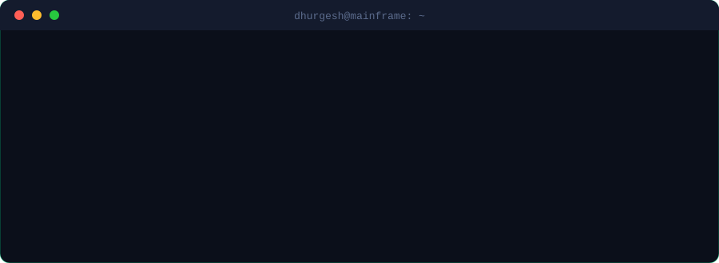
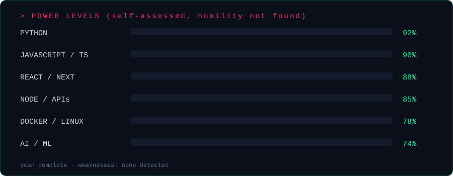

## > ./intro.sh

## > cat arsenal.txt

*"I don't pick favourite tools. I pick whatever makes the problem cry first."*

## > stats --flex

## > visualize --city

*Every building is a day. Taller = I was cooking.*

## > contributions --raw

## > connect --target me

&fontSize=28&fontColor=0b0f1a&animation=twinkling&fontAlignY=70)

*`rm -rf doubts/` · built different · compiled at 3 AM*
